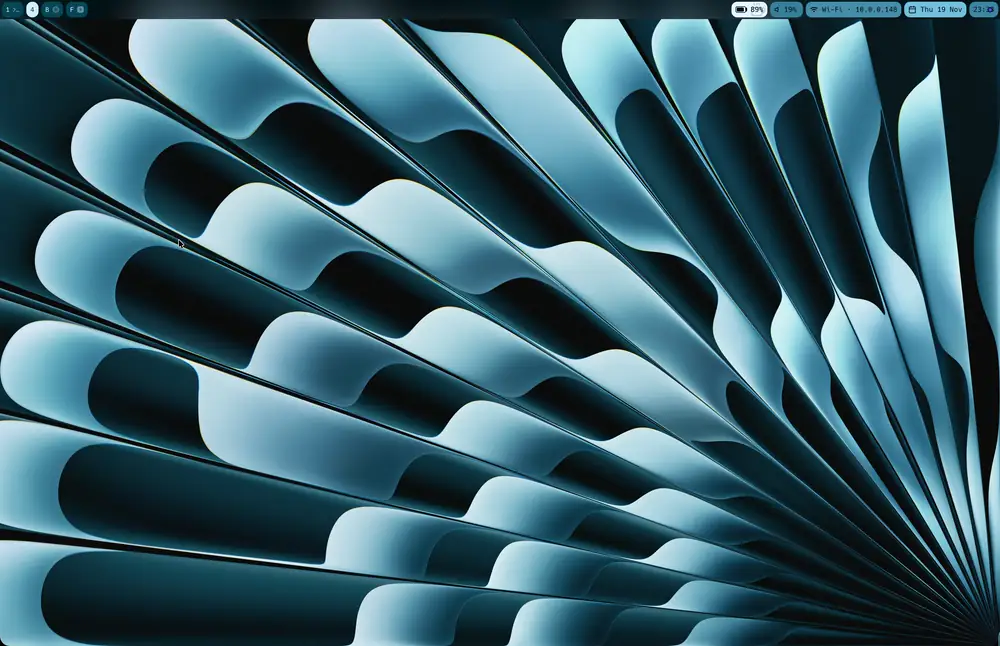
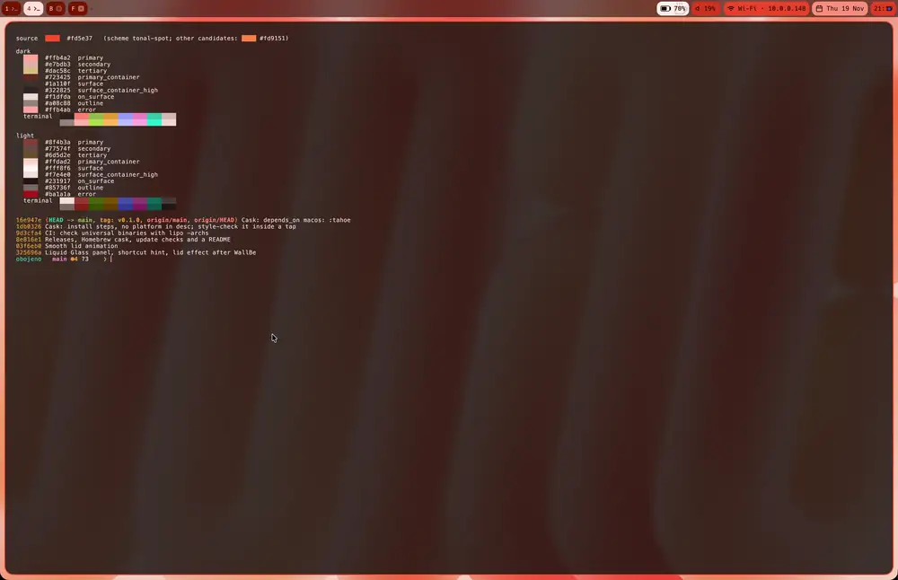
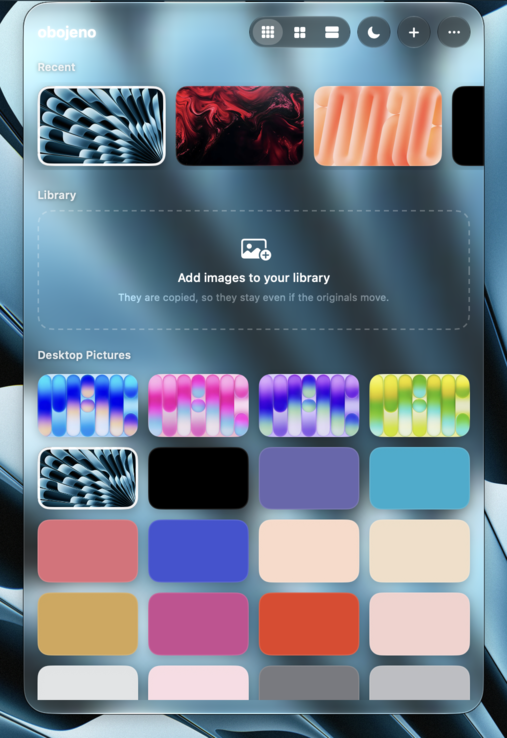
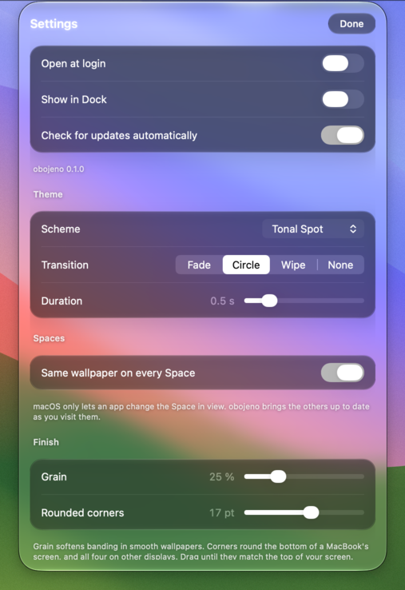

# obojeno

Wallpaper-driven Material You theming for macOS, like
[matugen](https://github.com/InioX/matugen), plus a menu bar app.

Pick a wallpaper and it fades in while kitty, Neovim, starship, simple-bar,
JankyBorders, Obsidian, Zen and herdr re-color to match. Switch between
light and dark and macOS and every app follow.

- **Menu bar app**: a Liquid Glass gallery of recent wallpapers, your library
  and your folders, a light/dark switch, and settings.
- **Daemon**: follows wallpaper changes from anywhere (System Settings,
  Spaces, other tools), appearance changes, and the menu bar app.
- **CLI**: everything the app does, plus palette previews and target setup
  help.
- **Desktop touches**: wallpaper transitions (fade, growing circle, wipe),
  film grain, rounded corners that match the MacBook screen, a lid
  animation, the same wallpaper on every Space, and global shortcuts.

The colors are Material Design 3 schemes from the wallpaper's dominant
color, the same as Android and matugen produce.

> Needs macOS 26 (Tahoe) or later.

## See it

**A new wallpaper**, with the growing-circle transition. The bar re-colors
with it:



<sub>[Full quality video](docs/wallpaper.mp4)</sub>

**Everything follows**: kitty, the window borders, the bar and the starship
prompt re-color with each wallpaper, and again when switching between dark
and light:



<sub>[Full quality video](docs/theming.mp4)</sub>

**The menu bar app**: the gallery and its settings, on Liquid Glass.

<p>
  
  
</p>

**Closing the lid** (MacBooks): the edges soften, darkness comes down from the
top and the wallpaper blurs and sinks, following the lid as it moves:


<sub>[Full quality video](docs/lid.mp4)</sub>

## Install

### Homebrew

```sh
brew install --cask st1vc3/tap/obojeno
```

This installs `Obojeno.app` and the `obojeno` command, ready to open with
no security prompt. Open the app once: it starts the daemon, lives in the menu
bar, and welcomes you with the apps it found on your Mac to choose from. Turn
on **Open at login** in its settings.

### Download

For Apple silicon and Intel Macs.

1. Download `Obojeno-<version>.zip` from the
   [latest release](https://github.com/st1vc3/obojeno/releases/latest) and
   unzip it (Finder does it on double-click).
2. Move `Obojeno.app` to `/Applications`.
3. Open it. The app is free and not notarized by Apple, so the first time
   macOS says it cannot check it. Open **System Settings → Privacy &
   Security**, scroll down and click **Open Anyway** next to Obojeno, then
   confirm. Or, in Terminal:

   ```sh
   xattr -dr com.apple.quarantine /Applications/Obojeno.app
   ```

   Then it starts like the Homebrew one does: turn on **Open at login** in
   its settings.

The `obojeno` command is inside the app. To use it in a terminal, link it
into your `PATH`:

```sh
sudo mkdir -p /usr/local/bin
sudo ln -sf /Applications/Obojeno.app/Contents/Helpers/obojeno /usr/local/bin/obojeno
```

The app updates itself: it checks once a day (or from **⋯ → Check for
Updates…**), and installs a new release and restarts when you say so. Every
update is signed, and the app refuses any that is not. Homebrew installs
update with `brew upgrade` instead.

### Nix (flake and Home Manager)

The flake builds the CLI and daemon. Its Home Manager module installs them,
runs the daemon at login and writes the config:

```nix
# flake.nix
inputs.obojeno.url = "github:st1vc3/obojeno";

# home-manager configuration
imports = [ inputs.obojeno.homeManagerModules.default ];
programs.obojeno = {
  enable = true;
  integrations.starship = true; # points STARSHIP_CONFIG at obojeno's file
  settings = {
    wallpaper_dirs = [ "~/Pictures/Wallpapers" ];
    transition = { style = "grow-circle"; duration = 0.8; };
    finish = { grain = 0.2; corner_radius = 18; };
    lid_animation = true;
    targets.kitty = { };
    targets.starship = { };
  };
};
```

The config is written as a regular file, so changes made in the menu bar app
last until the next switch. For the menu bar app, use the Homebrew cask or
build it from source.

### From source

```sh
nix develop -c ./scripts/build-app.sh   # or with cargo and Xcode / the Command Line Tools
open target/Obojeno.app
```

`target/Obojeno.app/Contents/Helpers/obojeno` is the CLI. Without the app,
`obojeno setup` turns on the apps it finds and `obojeno service install`
starts the daemon at login.

## Use

```sh
obojeno set ~/Pictures/dune.jpg   # wallpaper on every screen, with a transition
obojeno mode toggle               # light/dark for macOS and every app
obojeno next                      # next / previous / random gallery image
obojeno color '#ff4057'           # theme from a color; --wallpaper to go back
obojeno preview [image]           # show an image's palette in the terminal
obojeno import *.jpg              # copy images into the library
obojeno setup                     # turn on the apps found on this Mac, show what is left
obojeno targets [name]            # built-in targets and how to set one up
obojeno service status            # the daemon at login: install / uninstall / status
```

Commands talk to the daemon when it runs, so transitions animate; without it
they do the work themselves.

## Configure

`~/.config/obojeno/config.toml` (the menu bar app edits it too, keeping your
comments):

```toml
scheme = "tonal-spot"   # content, expressive, fidelity, fruit-salad,
                        # monochrome, neutral, rainbow, vibrant
contrast = 0.0          # -1 (reduced) to 1 (high)
library = "~/Pictures/obojeno"          # where imported images are copied
wallpaper_dirs = ["~/Pictures/Wallpapers"]
all_spaces = false      # the same wallpaper on every Space
lid_animation = false   # darkness and blur follow the MacBook lid

[transition]
style = "fade"          # fade, grow-circle, wipe, none
duration = 0.6          # seconds

[finish]
grain = 0.0             # film grain, 0 to 1
corner_radius = 0.0     # points; bottom corners on a MacBook, all four elsewhere

[targets.kitty]         # each table turns a target on
[targets.starship]
[targets.obsidian]
vault = "~/Notes"
```

Wallpapers without color (black, white, grays) always get the monochrome
scheme, so they don't turn the whole desktop a random hue.

### Targets

| Target | What obojeno writes | Setup |
|---|---|---|
| `kitty` | `~/.cache/obojeno/kitty.conf` | `include ~/.cache/obojeno/kitty.conf` in kitty.conf; reloads live |
| `borders` | nothing | updates the running [JankyBorders](https://github.com/FelixKratz/JankyBorders) |
| `simple-bar` | colors merged into `~/.simplebarrc`, a blurred wallpaper | none; option `base` merges from another file |
| `nvim` | `~/.cache/obojeno/nvim/colors/obojeno.lua` | `obojeno targets nvim` prints the init.lua snippet; reloads live |
| `starship` | your config with an `obojeno` palette, in `~/.cache/obojeno/starship.toml` | `STARSHIP_CONFIG` pointing there |
| `herdr` | `~/.cache/obojeno/herdr.toml` | `HERDR_CONFIG_PATH` pointing there |
| `obsidian` | the `obojeno` CSS snippet in your vault | option `vault`; enable the snippet |
| `zen` | `userChrome.css` in your profile | option `profile`; applies on the next start |

Every target takes `enabled`, `template`, `output`, `reload` (a list of
commands, `[]` for none) and `only_if_running`. A table with a name that is
not built in is a custom target:

```toml
[targets.foot]
template = "~/.config/obojeno/templates/foot.ini"
output = "~/.cache/obojeno/foot.ini"
reload = [["pkill", "-USR1", "foot"]]
```

### Templates

Templates use matugen's variables, so matugen templates mostly work as they
are:

- `{{colors.<role>.<default|light|dark>.<format>}}`: every Material role
  (`primary`, `on_surface`, `surface_container_high`, ...) for the current mode
  (`default`) or a fixed one. Formats: `hex`, `hex_stripped`, `rgb`, `rgba`,
  `hsl`, `red`, `green`, `blue`.
- `{{term.color0}}` to `{{term.color15}}`: a 16-color terminal palette in the
  wallpaper's hues, with the same modes and formats.
- `{{palettes.<name>.<tone>.hex}}`: tonal palettes (`primary`, `secondary`,
  `tertiary`, `neutral`, `neutral_variant`, `error`, and `source` for the
  wallpaper's own hue) at tones 0 to 100.
- `{{source_color.hex}}`, `{{mode}}`, `{{is_dark}}`, `{{wallpaper}}`, the
  target's options, and `{{home}}`, `{{config}}`, `{{cache}}`.
- Filters: `upper`, `lower`, `replace`.

## Menu bar app

The gallery shows recent wallpapers, your library (images added with **+**
are copied there) and your folders, in three sizes. Click to set one;
right-click to show it in Finder or remove it from the library.

**Settings** has the apps to theme (with the one-time setup each needs, and
a Copy button for it), open at login, show in Dock, automatic update checks, the
scheme, transitions, Spaces, grain, corners, the lid animation, folders and
shortcuts for next, previous and random wallpapers.

## Troubleshooting

The daemon logs to `~/Library/Logs/obojeno.log` (**⋯ → Show Log** in the menu
bar app), and moves it to `obojeno.log.1` once it passes 5 MB. The app keeps its
daemon running: it starts it when none runs,
restarts it after a crash, and replaces it after an update. `obojeno -v
daemon` runs one in the terminal instead.

simple-bar is refreshed through Übersicht, so macOS asks once whether obojeno
may control it. Switching between light and dark needs no permission.

## Uninstall

```sh
brew uninstall --cask obojeno            # --zap also removes config and caches
```

Without Homebrew: if you ran `obojeno service install`, run
`obojeno service uninstall` first. Then quit the app (**⋯ → Quit obojeno**),
move it to the Trash, and remove what it left behind:

```sh
pkill -f "obojeno.*daemon"               # the daemon keeps running after the app quits
sudo rm -f /usr/local/bin/obojeno        # if you linked the command
rm -rf ~/.cache/obojeno ~/.config/obojeno ~/.local/state/obojeno ~/Library/Logs/obojeno.log* \
  ~/Library/Caches/io.github.st1vc3.obojeno ~/Library/HTTPStorages/io.github.st1vc3.obojeno
```

Your library in `~/Pictures/obojeno` is left alone.

## Develop

```sh
nix develop                     # Rust toolchain, clippy, rustfmt, cargo-insta
cargo test --workspace          # palettes are checked against Google's reference
./scripts/build-app.sh          # the app; UNIVERSAL=1 for both architectures
```

[CONTRIBUTING.md](CONTRIBUTING.md) has the rest: where things are, the checks
CI runs, and how releases work. Report vulnerabilities privately; see
[SECURITY.md](SECURITY.md).

## License

MIT
